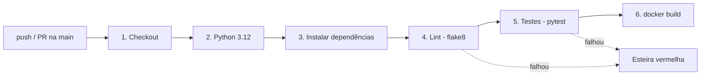

# FastOrder API


API REST em **Python + Flask** com uma esteira de **Integração Contínua** no **GitHub Actions**. A cada `push` ou `pull request` na `main`, a esteira baixa o código, faz o lint com **flake8**, roda os testes com **pytest** e empacota a aplicação numa imagem **Docker**.

Projeto do **Estudo Guiado 01 — Pipeline CI: Integração Contínua, Testes e Deploy com Docker**.

---

## Equipe

- Sheila Barroso
- Arthur Rebouças
- Carlos Rodrigo Ferreira
- Vitória Cavalcante

---

## Tecnologias

| Ferramenta | Versão | Para que serve |
|---|---|---|
| Python | 3.12 | Linguagem da aplicação |
| Flask | 3.0.3 | Micro-framework web que expõe as rotas da API |
| pytest | 8.3.3 | Execução dos testes automatizados |
| flake8 | 7.1.1 | Lint: análise estática e padrão de estilo PEP 8 |
| Docker | — | Empacota a aplicação num contêiner reprodutível |
| GitHub Actions | — | Executa a esteira de CI a cada commit |

---

## Estrutura do projeto

```
fastorder-api/
├── .github/
│   └── workflows/
│       └── ci-pipeline.yml          # Esteira de CI (GitHub Actions)
├── app.py                           # API Flask
├── test_app.py                      # Testes automatizados (pytest)
├── requirements.txt                 # Dependências com versões fixadas
├── Dockerfile                       # Imagem da aplicação
├── .dockerignore                    # Arquivos fora da imagem
├── .flake8                          # Configuração do lint
├── .gitignore
└── relatorio_estudo_guiado_01.md    # Respostas da Pesquisa Inicial e Questões para Análise
```

---

## Endpoints

Os parâmetros `a` e `b` são lidos da URL com `request.args.get()` e convertidos para número. Se algum faltar ou não for numérico, a API responde **HTTP 400**.

| Método | Rota | Exemplo | Resposta |
|---|---|---|---|
| GET | `/` | `/` | `{"status": "online", "servico": "FastOrder API"}` |
| GET | `/api/soma` | `/api/soma?a=5&b=7` | `{"operacao": "soma", "resultado": 12}` |
| GET | `/api/subtracao` | `/api/subtracao?a=10&b=4` | `{"operacao": "subtracao", "resultado": 6}` |
| GET | `/api/multiplicacao` | `/api/multiplicacao?a=3&b=4` | `{"operacao": "multiplicacao", "resultado": 12}` |
| GET | `/api/divisao` | `/api/divisao?a=10&b=4` | `{"operacao": "divisao", "resultado": 2.5}` |

Respostas de erro:

```json
// GET /api/soma?a=5
{"erro": "Parâmetros 'a' e 'b' são obrigatórios"}

// GET /api/soma?a=abc&b=2
{"erro": "Parâmetros 'a' e 'b' devem ser numéricos"}

// GET /api/divisao?a=10&b=0
{"erro": "Divisão por zero não é permitida"}
```

---

## Como rodar localmente

**Pré-requisitos:** Python 3.x, Git e Docker Desktop.

```bash
# 1. Clonar o repositório
git clone https://github.com/sheilabarroso/fastorder-api.git
cd fastorder-api

# 2. Criar e ativar o ambiente virtual
python -m venv venv
source venv/bin/activate        # Linux/macOS
venv\Scripts\activate           # Windows

# 3. Instalar as dependências
pip install -r requirements.txt

# 4. Subir a API
python app.py
```

Acesse: <http://localhost:5000/api/soma?a=5&b=7>

### Lint e testes

```bash
flake8 .        # sem saída = nenhum problema encontrado
pytest -v       # 10 testes devem aparecer como PASSED
```

Os testes usam o `test_client` do Flask, que simula requisições sem subir servidor, e cobrem:

- soma de inteiros, decimais e negativos;
- parâmetro ausente e parâmetro inválido (HTTP 400);
- subtração, multiplicação e divisão;
- divisão por zero (HTTP 400).

---

## Docker

```bash
# Construir a imagem
docker build -t fastorder-api:latest .

# Rodar o contêiner
docker run -d -p 5000:5000 --name meu-backend fastorder-api:latest

# Testar
curl "http://localhost:5000/api/soma?a=5&b=7"

# Parar e remover
docker stop meu-backend && docker rm meu-backend
```

O `Dockerfile` copia o `requirements.txt` e instala as dependências **antes** de copiar o código. Assim, o Docker reaproveita o cache dessa camada quando só o código muda, e o ambiente fica definido em código, igual para Dev e Ops.

---

## Esteira de CI (GitHub Actions)

O workflow `.github/workflows/ci-pipeline.yml` roda num **GitHub-hosted runner** (`ubuntu-latest`), uma máquina virtual criada limpa a cada execução e destruída ao final.



| Passo | Comando | Por que nesta posição |
|---|---|---|
| 1. Checkout | `actions/checkout@v4` | Baixa o código no runner |
| 2. Python | `actions/setup-python@v5` | Instala o Python 3.12 |
| 3. Dependências | `pip install -r requirements.txt` | Prepara o ambiente |
| 4. Lint | `flake8 .` | Leva segundos; barra erros de sintaxe e estilo antes de tudo |
| 5. Testes | `pytest -v` | Garante que a lógica está correta |
| 6. Build | `docker build -t fastorder-api:latest .` | Etapa mais cara; só roda se o código já foi aprovado |

As etapas vão da mais barata para a mais cara (*fail fast*, *Shift-Left*): se o lint ou os testes falham, o build Docker nem é executado e não se gasta tempo de runner à toa.

### Teste de fogo (Andon Cord)

Para provar que a esteira barra erros, introduzimos um bug proposital na rota da soma (`a + b` → `a - b`):

1. O **lint passa**, porque o código continua válido.
2. O **pytest falha** em 3 testes: `test_soma`, `test_soma_decimais` e `test_soma_negativos` (ex.: `assert -2 == 12`).
3. O **passo 6 (Docker) não executa**: o bug é barrado antes de virar imagem.
4. Após a correção e um novo push, a esteira volta a ficar **verde**.

O histórico completo das execuções está na aba [Actions](https://github.com/sheilabarroso/fastorder-api/actions).

---

## Relatório

As respostas da **Seção 4 (Pesquisa Inicial)** e das **Questões para Análise** estão em [`relatorio_estudo_guiado_01.md`](relatorio_estudo_guiado_01.md):

- ❓ 4.1 — O que é um Runner e onde o código roda no GitHub
- ❓ 4.2 — O que é Linting e por que rodar o flake8 antes dos testes
- ❓ 4.3 — Diferença entre VM e contêiner Docker
- Questão 1 — Como o pipeline altera o Lead Time
- Questão 2 — Por que lint e testes vêm antes do `docker build`
- Questão 3 — Como o Dockerfile resolve o "Muro da Confusão"

---

## Próximos passos (CI/CD)

Fora do escopo obrigatório da prática:

- Publicar a imagem num Container Registry (Docker Hub ou GHCR), com credenciais em *Settings › Secrets and variables › Actions*.
- Fazer o deploy automático numa plataforma PaaS (Render, Railway, Fly.io) via webhook, ou num VPS via SSH.
- Trocar o servidor de desenvolvimento do Flask por um servidor WSGI de produção (ex.: Gunicorn).
